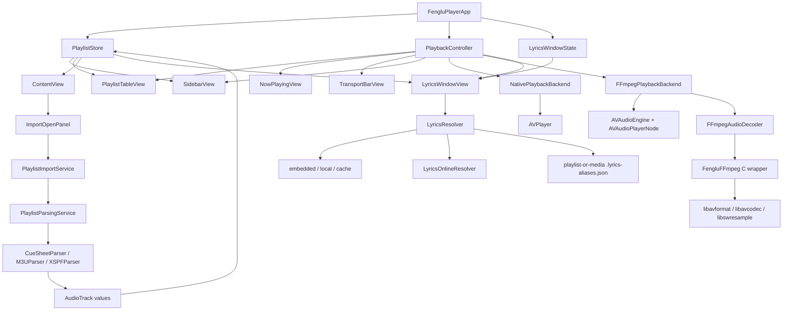
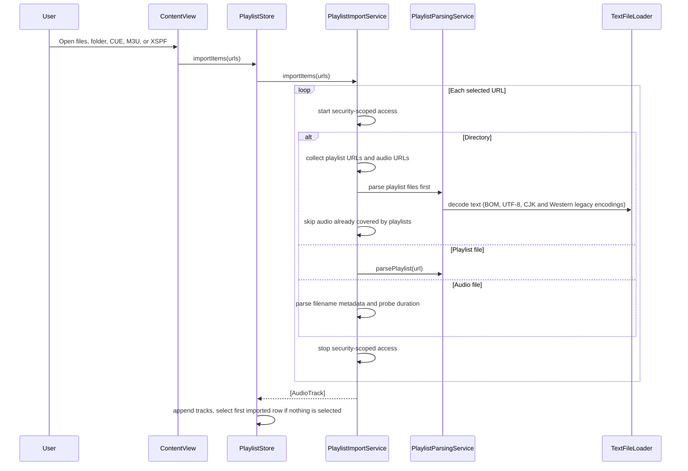
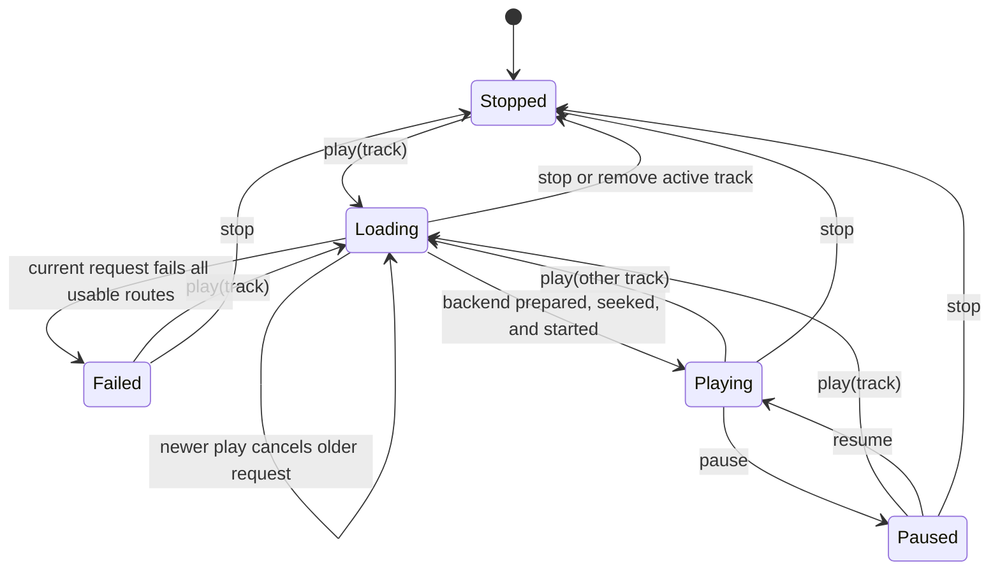
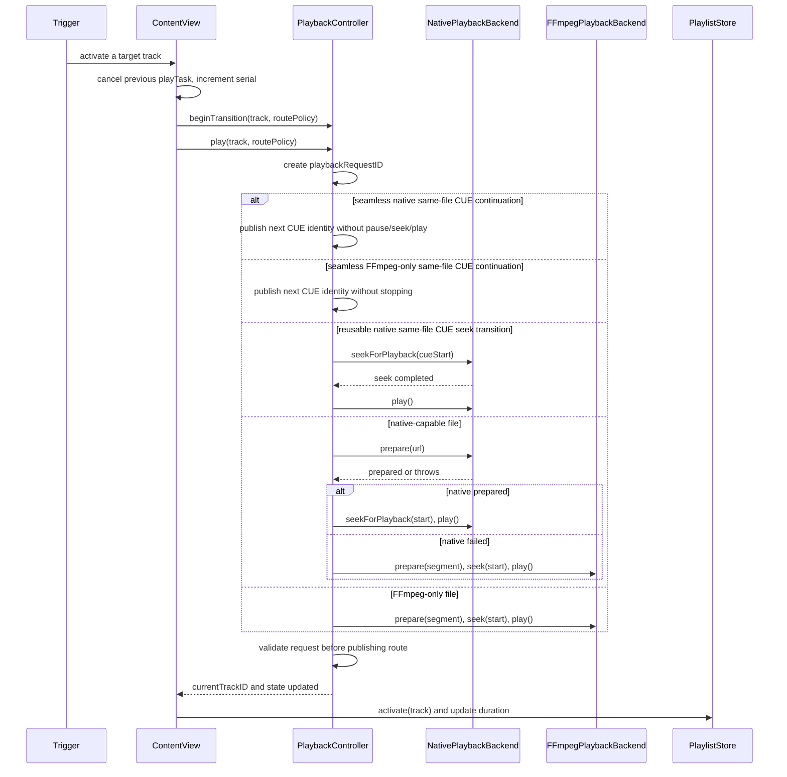
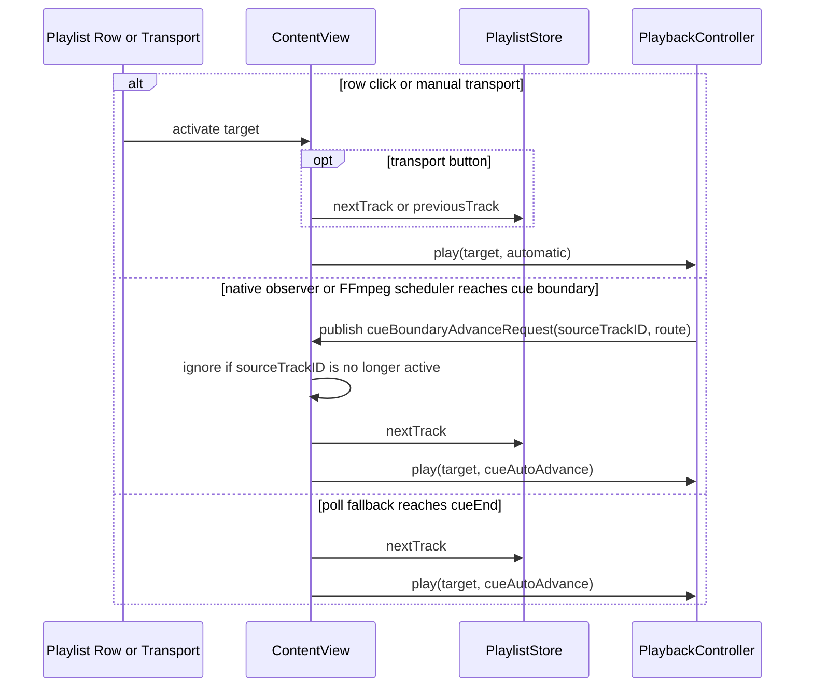
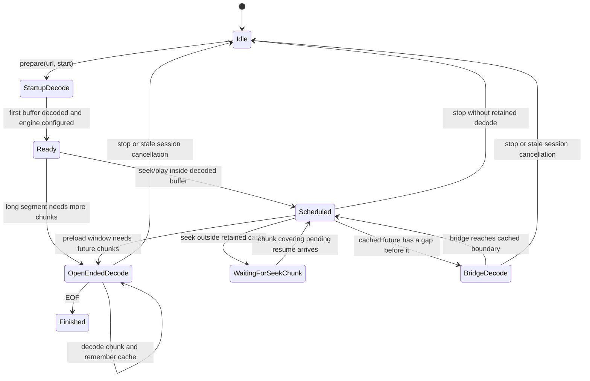
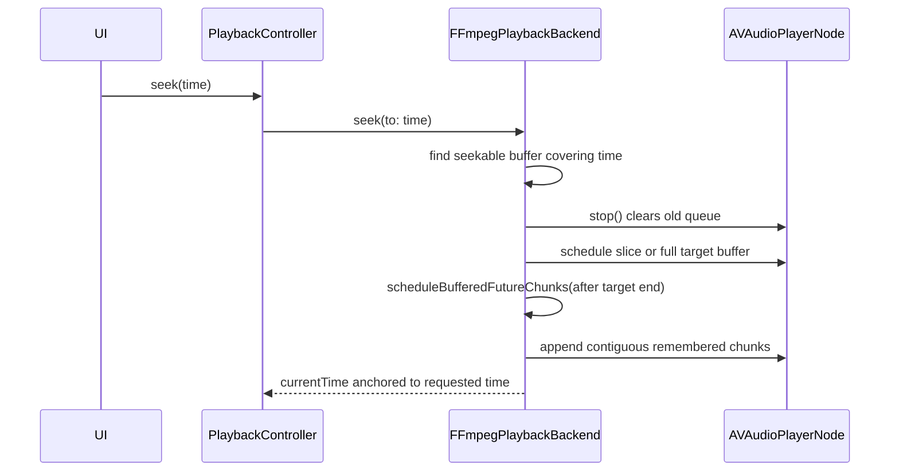
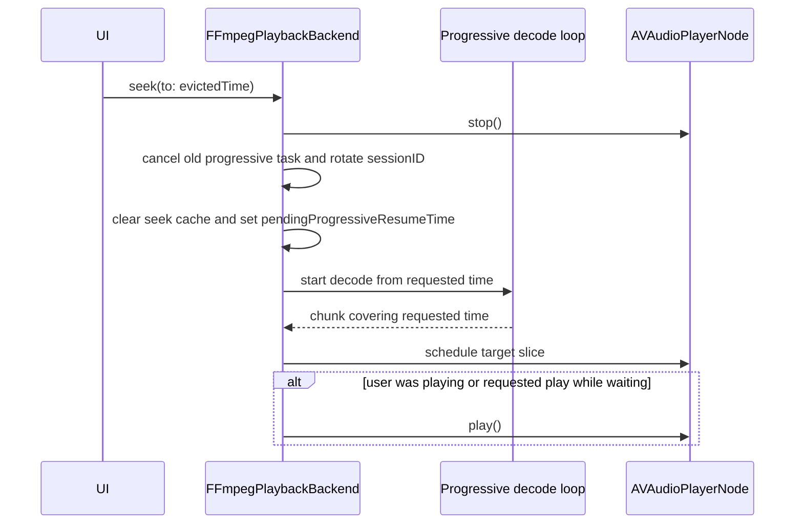
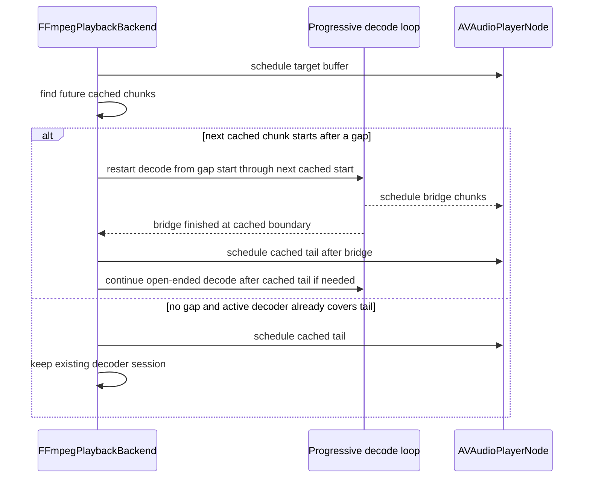
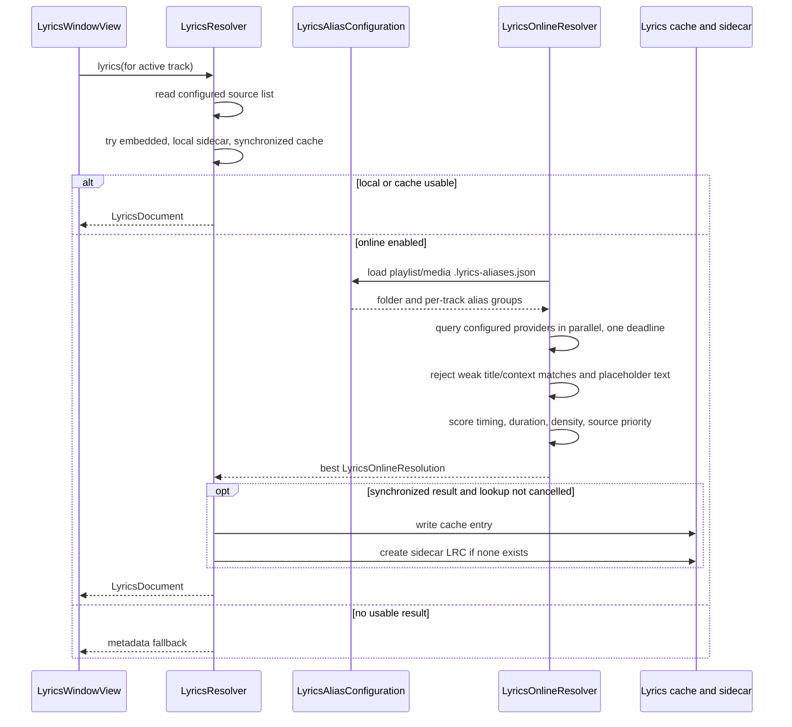

# Fenglu Player Architecture

How the app is put together: targets, object graph, playback routing, the FFmpeg
backend, lyrics lookup, and the invariants the code relies on. For building,
using, and configuring the app see the [README](../README.md).

Fenglu Player is a Swift Package Manager macOS app split into four targets:

- `FengluPlayer` is the SwiftUI app, stores, views, playlist import, playback
  orchestration, lyrics lookup, and debug logging.
- `FengluFFmpeg` is a small C wrapper around FFmpeg APIs. Swift calls this
  wrapper instead of calling `libav*` directly.
- `CFFmpeg` is either a SwiftPM system-library target discovered by `pkg-config`
  or a static-link shim generated from `Sources/CFFmpegStatic`, depending on the
  FFmpeg environment variables.
- `FengluPlayerTests` holds the offline regression tests and their fixtures.

The main design rule is that UI state is stable and centralized, while decoding
work is cancellable and guarded. The user can click tracks, press Next/Previous,
seek, filter the table, or open the lyrics window while a previous decoder task
is still unwinding. The code therefore treats every playback start and every
progressive FFmpeg decode as a session that can become stale.

## Source Layout

```text
Sources/FengluPlayer/App
  App entry, app delegate, File menu, Lyrics menu, window commands, and app root.

Sources/FengluPlayer/Models
  Plain model types for tracks, decoder routes, and lyrics documents. Some
  small supporting types, such as TrackSource, PlaybackState, and LyricsLine,
  are co-located in those model files.

Sources/FengluPlayer/Stores
  ObservableObject state for playlist rows, selected row, active playback row,
  filters, import errors, and lyrics window visibility.

Sources/FengluPlayer/Views
  SwiftUI and AppKit-backed UI: main split view, sidebar, playlist table,
  transport bar, toolbar, now-playing view, level meter, and lyrics window.

Sources/FengluPlayer/Services/Playlists
  Import, parser, and export services for folders, audio files, CUE, M3U/M3U8,
  XSPF import, and XSPF playlist export.

Sources/FengluPlayer/Services/Audio
  PlaybackController plus AVFoundation and FFmpeg playback backends, route
  policy, output-device enumeration and selection, and playback errors.

Sources/FengluPlayer/Services/Lyrics
  Lyrics source configuration, local/cache lookup, online resolvers, alias
  configuration, LRC/plain-text parsing, scoring, rejection, and fallback.

Sources/FengluPlayer/Support
  Shared utilities: debug logging, file type lists, duration probing,
  filename metadata parsing, native-format heuristics, text-file decoding,
  open/save panel integration, time formatting, non-empty string helpers,
  window access, and related utilities.

Sources/FengluFFmpeg
  C bridge that decodes full files or absolute-time media segments through
  FFmpeg.
```

## Runtime Object Graph

`FengluPlayerApp` creates the long-lived objects once:

- `PlaylistStore` owns imported tracks, selection, active track, filters, and
  duration updates observed after playback starts.
- `PlaybackController` owns the playback state machine and the two concrete
  decoder backends.
- `LyricsWindowState` controls whether the standalone lyrics window is visible.

Those objects are injected into the main window, commands, and lyrics window so
menus, toolbar buttons, playlist clicks, transport controls, sidebar counts, and
lyrics lookup all observe the same state.



## Threading And Ownership

`PlaybackController`, `NativePlaybackBackend`, and `FFmpegPlaybackBackend` are
`@MainActor`. UI updates, backend ownership changes, player-node scheduling, and
published state changes happen on the main actor. Expensive FFmpeg decoding is
performed inside detached tasks, then the decoded result is installed back on the
main actor only if the request/session is still current.

Important ownership boundaries:

- `ContentView` owns the UI-level play task. Starting another row cancels the
  older task and increments a request serial used for store activation.
- `PlaybackController` owns `playbackRequestID`. Any awaited route preparation
  must validate that ID before mutating published playback state.
- `FFmpegPlaybackBackend` owns `progressiveSessionID`. Progressive chunks,
  bridge completion, EOF, and error paths are ignored if their session is stale.
- Backends own media resources. `PlaybackController.stop()` is the full reset
  path that stops the active backend and clears route/current/loading state.

## Data Model

`AudioTrack` is intentionally small and value-like. A standalone file has only a
URL plus optional metadata and duration. A playlist item may carry
`playlistName`. A CUE track keeps the same media URL as the physical file but
adds `trackNumber`, `cueStart`, and `cueEnd`.

All CUE playback times are absolute times inside the media file. The UI can show
elapsed CUE-relative time by subtracting `cueStart`, while the backends can seek
and report positions in the native file timeline.

## Playlist Import Flow

`PlaylistImportService` accepts files, folders, and security-scoped URLs from
the open panel. Folders are enumerated recursively. Playlist files are parsed
first; audio files already referenced by those playlists are skipped so an album
folder with both `CD.cue` and `CD.ape` does not produce duplicate rows.

The packaged app also registers a Finder service named **Add to Fenglu Player
Playlist**. It appears in Finder's Services/Quick Actions context menu for file
selections and imports those items at the end of the current playlist without
interrupting or changing playback. The service accepts generic file and folder
types so formats with dynamically assigned macOS types, including `.cue`, are
available in Finder as well.

Closing Fenglu Player's last window terminates the application. Both window-close
termination and Command-Q explicitly stop the active playback backend first, so
audio cannot continue after the GUI exits.



Playlist text is decoded by `TextFileLoader`: a byte-order mark wins, then
UTF-8, then the legacy CJK encodings (GB18030/GBK, Shift-JIS, Big5), then
Western single-byte encodings. `CueSheetParser` binds each track to the `FILE`
entry that owns its `INDEX 01`, so sheets that place `FILE` after `TRACK` (the
EAC "non-compliant" gap layout) resolve to the right media. When a CUE names a
media file that does not exist, the same base name is tried with every
supported audio extension (for example `album.wav` re-encoded to `album.flac`).

## Playlist Export Flow

`File > Save Playlist As...` exports the current playlist to XSPF without
changing playback state. `PlaylistSavePanel` presents the save location, default
names the file from the first track's playlist name when available, and
`XSPFExporter` writes one `<track>` entry per current playlist row. Exported
tracks include standardized file URLs, title, artist, album, track number,
duration, and Fenglu extension fields for CUE `cueStart` and `cueEnd` so parsed
CUE rows can be imported again later.

## Playback Route Design

`PlaybackController` is the single playback coordinator. It publishes
`PlaybackState`, `DecoderRoute`, `currentTime`, `duration`, `loadingTrackID`,
`currentTrackID`, and `volume`.

Two backends implement the same `PlaybackBackend` protocol:

- `NativePlaybackBackend` wraps `AVPlayer`. It is preferred for formats macOS
  usually decodes well, including AAC, MP3, WAV, AIFF, CAF, M4A, and FLAC. It
  supports same-file CUE jumps by reusing the prepared `AVPlayer`. Natural
  adjacent CUE auto-advance is handled as a seamless continuation when the
  player is already at the next CUE start, so it does not pause, seek, or call
  play again at the track boundary.
- `FFmpegPlaybackBackend` decodes through `FFmpegAudioDecoder`, schedules PCM
  through `AVAudioEngine`, and is preferred for APE, WV, OGG, Opus, DSF, and
  DFF.

Route selection is automatic and based on file capability:

- User-initiated playback, including playlist row activation and manual
  Next/Previous, uses `.automatic`. It tries native first only when
  `NativeFormatHeuristics.prefersNativeDecoder(for:)` says the file is native
  capable; other formats go directly to FFmpeg. Manual same-file CUE jumps
  reuse the prepared native backend when possible instead of forcing a decoder
  change.
- Natural CUE auto-advance uses `.cueAutoAdvance`, which follows the same
  capability heuristic while allowing safe seamless continuation. If the
  native backend is already playing the same file and has reached, or is within
  the tiny early epsilon before, the next CUE start, the controller only changes
  published track identity and duration. FFmpeg-only same-file CUE playback can
  likewise continue through the boundary without changing backends. Late
  natural boundary callbacks continue forward instead of seeking backward.
- The polling fallback advances a CUE only when `currentTime >= cueEnd`; it does
  not use the 50 ms non-CUE duration tolerance. Native CUE playback also
  installs an `AVPlayer` boundary-time observer for `cueEnd` so natural
  same-file advances do not depend on the 100 ms UI polling timer.
- Native seeks to CUE starts use zero tolerance; the looser native startup
  tolerance is reserved for non-CUE playback starts.

The table route column and sidebar FFmpeg count distinguish route preference
from the live backend. Inactive rows show `Native first` or `FFmpeg likely`.
Only the loading row shows `Loading`, and only the current row shows the live
`Native` or `FFmpeg` route.

## Output Device

`AudioOutputDevice` enumerates Core Audio output devices for the transport
bar's picker. With **System Default** selected the app follows the system
default device, including when the previous default disappears; only an
explicitly chosen device is pinned. Multichannel files (more than two channels)
are playable on the FFmpeg route.

## PlaybackController FSM



The controller guards this FSM with `playbackRequestID`. A stale route prepare
may finish later, but it must not publish `state`, `route`, `currentTrackID`, or
failure state after a newer request has taken over.

## Play Request Sequence



## Track Transition Route Sequence



## FFmpeg Progressive Decode Design

FFmpeg playback uses a short startup decode followed by progressive chunk
decoding. The current constants are:

- Startup decode: 10 seconds.
- Progressive chunk size: 45 seconds.
- Decode-ahead target: 90 seconds ahead of current playback.
- Retained seek cache: roughly the newest 180 seconds or 256 MB of PCM,
  whichever limit is hit first, while preserving the currently scheduled buffer.

Every chunk is a fresh open-and-seek in the C shim. The shim seeks to the packet
at or before the requested time (with a short pre-roll for lossy codecs), then
trims decoded frames to the exact sample, so consecutive chunks join without a
gap or overlap. Undecodable packets are skipped and replaced with silence so the
timeline stays correct. A decode carries a cancellation token that the shim
polls, so a superseded seek stops promptly. There is no segment end: CUE track
ends are handled by the controller, not by the decode loop.

The backend schedules PCM on `AVAudioPlayerNode`. A call to `playerNode.stop()`
clears the entire queued audio list, so every seek must schedule the target
buffer and then requeue any contiguous remembered future buffers. Stopping the node
also fires the completion handlers of flushed buffers, so each stop bumps a
generation counter and CUE-boundary callbacks from an older generation are
ignored. The same rebuild runs after an output-device change and after an
`AVAudioEngineConfigurationChange` notification.

Important progressive data:

- `decodedAudio` is the buffer currently anchoring local playback time.
- `seekableDecodedBuffers` is the bounded cache of decoded chunks that can be
  used for backward/nearby seeks.
- `pendingProgressiveResumeTime` stores a requested seek target that is not
  decoded yet.
- `shouldPlayPendingProgressiveResume` records whether playback should start
  automatically when that pending target arrives.
- `progressiveNextStartTime`, `progressiveRequestedEndTime`, and
  `progressiveBridgeEndTime` describe the active decode loop.
- `progressiveSessionID` makes old chunk, EOF, bridge, and error callbacks
  harmless after a restart or stop.

## FFmpeg Progressive Backend FSM



## FFmpeg Seek And Cache Sequences

Seek inside retained cache:



Seek outside retained cache:



Bridge a cache gap without re-decoding the cached tail:



## Lyrics Design

Lyrics are shown in a separate SwiftUI window controlled by `LyricsCommands`.
`LyricsWindowView` observes the active playlist track and playback time, then
asks `LyricsResolver` for a `LyricsDocument`. A result is displayed only if its
lookup is still the current one for that window; a cancelled lookup neither
replaces the display nor writes anything to disk.

`LyricsResolver` walks the configured source list (see the README for the
default order, configuration, sidecar naming, and cache location). The
`embedded` source name is recognized but not implemented, because `AudioTrack`
does not store embedded lyric tags. When nothing usable is found the window
shows a metadata fallback containing the track title and available tags.

`LyricsOnlineResolver` queries the configured online providers in parallel
under one overall deadline, rejects weak matches and placeholder text, and
scores the survivors. The acceptance rules are in
[LYRICS_MATCHING.md](LYRICS_MATCHING.md).

`LyricsParser` handles synchronized LRC timestamps, plain text lyrics, offset
tags, bad page chrome, credit-only text, and placeholder lines. This keeps
one-line "no lyrics" responses from being cached or shown as real lyrics.
`[offset:]` follows the common LRC convention: a positive value makes lyrics
appear earlier.

## Lyrics Lookup Sequence



## Debugging Design

`DebugLog` writes each event to both unified logging (`com.fenglu.player`) and
standard error with a `[Fenglu]` prefix. Running with
`./script/build_and_run.sh --console` keeps menu actions, import parsing,
playlist selection, playback route decisions, FFmpeg decoding, progressive
session changes, route fallbacks, lyrics source decisions, alias loading, and
cache/sidecar writes visible in the terminal.

## Core Invariants

- `PlaybackController` is the only object that publishes the live decoder route.
- Inactive playlist rows show route preference, not stale live backend state.
- Every async playback route validates `playbackRequestID` after awaits and
  before publishing state or failure.
- Every FFmpeg progressive callback validates `progressiveSessionID` and active
  decode state before installing chunks or terminal state.
- A seek that calls `playerNode.stop()` must rebuild the queue from the target
  buffer forward.
- A natural native same-file CUE auto-advance must not pause, seek, or restart
  playback when the active `AVPlayer` is already at the next CUE start.
- CUE boundaries are route-neutral requests. Native uses an `AVPlayer`
  boundary-time observer. FFmpeg owns boundary timing in its scheduler and uses
  one explicit boundary mode per prepared track: `continueThroughBoundary`
  schedules pre- and post-boundary PCM and permits a same-FFmpeg identity
  handoff; `stopAtBoundary` schedules only the pre-boundary PCM and allows the
  next `.cueAutoAdvance` to retry the normal native-first route. The 100 ms
  polling loop remains as a UI-clock fallback and refresh driver; unlike
  route-neutral boundary requests, the poll trigger does not carry a source
  track ID, so it relies on the current store/playback state rather than the
  stricter stale-request validation used by boundary callbacks.
- If FFmpeg schedules post-boundary audio, the next boundary transition stays
  on FFmpeg when the `.cueAutoAdvance` timing gate permits seamless continuation.
- If the next transition may return to native, FFmpeg must stop scheduling
  exactly at `cueEnd` and fire the boundary callback from the pre-boundary
  buffer completion.
- FFmpeg seamless continuation is gated by file capability, `.cueAutoAdvance`,
  and timing. It is allowed only for FFmpeg-only handoffs when the backend is
  already prepared for the same file and the decoder time is close to the target
  CUE start and still before that CUE's end.
- Seeks are ignored while `PlaybackController` has an active loading
  transition (`state == .loading` or `loadingTrackID != nil`) so UI slider
  writes cannot remap onto a newly selected CUE before playback finalizes.
- The transport slider seeks once, when the drag ends. It keeps the track ID and
  `cueStart` captured when editing began, and the seek is dropped if playback
  has moved to another track in the meantime.
- A progressive cache miss restarts decode from the requested time instead of
  silently clamping to the first retained chunk.
- CUE times stay absolute for backend seek/current-time math and are converted
  to track-relative time only for display.
- Lyrics sidecars and alias files are colocated with the playing media or CUE
  playlist so albums can be corrected without global rules.
- A lyrics sidecar is only ever created, never replaced: an existing file at the
  sidecar path is left untouched, and cancelled or unsynchronized results are
  not written.
- Next, Previous, and auto-advance walk the visible (filtered and searched)
  playlist order, not the full track list.
